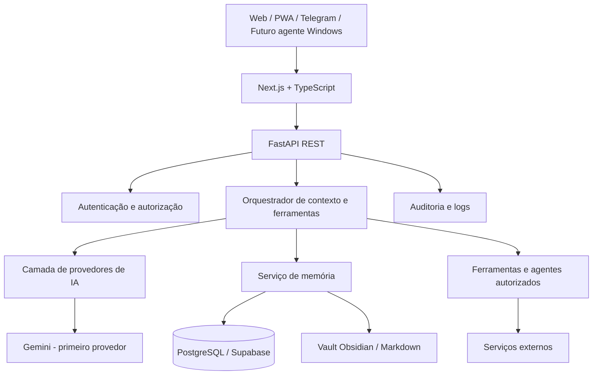

# Arquitetura inicial

## Princípio

O D.A.R.V.I.S. é o produto e o núcleo de orquestração. O modelo de IA é um provedor substituível, não a memória permanente nem a autoridade de permissões.

## Visão lógica

## Responsabilidades

- **Frontend:** interação, visualização e coleta de intenção. Não armazena segredos.
- **FastAPI:** autenticação, autorização, validação, regras de domínio e API.
- **Orquestrador:** seleciona contexto, ferramentas permitidas e provedor configurado.
- **Memória:** separa fatos estruturados, notas Markdown e histórico de conversas.
- **PostgreSQL:** fonte de verdade operacional para tarefas, projetos, permissões e metadados.
- **Obsidian:** interface portátil de conhecimento em Markdown; sincronização controlada para evitar conflitos.
- **Auditoria:** registra ferramenta, solicitante, parâmetros relevantes, aprovação e resultado sem expor segredos.

## Decisões iniciais

1. Não acoplar regra de negócio ao Gemini.
2. Não usar o histórico bruto de conversa como única memória.
3. Não executar ações destrutivas sem confirmação explícita.
4. Manter tokens e chaves apenas no backend/secret manager.
5. Começar com um usuário e tenancy simples, mas modelar `user_id` desde o início.
6. Tratar sincronização Obsidian como fluxo com conflitos e trilha de alterações, não como espelhamento cego.
